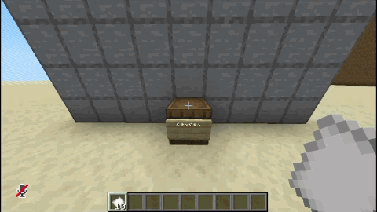

### 🌐 Language / 言語
英語 [日本語](README_ja.md)

# 🎁 GachaPlugin

 

A simple and feature-rich Minecraft plugin that allows you to set up and manage barrels as custom gacha blocks.

## 📋 Requirements

* **Minecraft / Server**: Paper / Spigot `1.20.1`
* **Java**: `Java 17`

## ✨ Features

* **Turn Barrels into Gacha Blocks**: Easily register existing barrels as gacha blocks using simple commands.
* **Flexible Cost Settings**: Specify the item held in your hand as the "currency item" upon registration. If you are empty-handed, the gacha can be rolled for free (no cost).
* **Toggle Item Consumption**: Individually configure whether winning items are removed from the barrel's inventory (consume stock) or remain infinite.
* **Intuitive Preview Function (ViewGUI)**: Sneak and click on a registered gacha block to open a GUI where you can check the reward lineup and required currency items.
* **Rich Roll Animations**: Enjoy custom rolling animations using `ItemDisplay` entities when spinning the gacha.
* **Customizable Messages**: All system messages and error notices can be fully customized via `messages.yml`.

---

## 🛠️ How to Use

### For Administrators (Setting up a Gacha)
1. Place a **barrel** where you want the gacha to be.
2. Put the **items you want to be won** inside the barrel (you can adjust drop rates by placing multiple copies of an item).
3. Look directly at the barrel and run the command `/gacha set [true/false]`.
    * If you want to set a currency, **hold the desired currency item in your hand** when executing the command.

### For Players (Rolling and Checking)
* **Roll the Gacha**: **Right-click** the registered barrel (if a currency is required, hold the item in your hand while clicking).
* **Check Contents & Cost**: **Sneak (Shift) and right-click** the registered barrel to open the preview GUI (ViewGUI). If a currency item is required, it will be displayed in the center slot.

---

## 📦 Commands

| Command | Description |
| :--- | :--- |
| `/gacha set [true/false]` | Registers the targeted barrel as a gacha block. • **Holding an item**: Sets it as the currency item. • **Empty-handed**: Sets it to free (no cost). • `true`: Consumes winning items from the barrel inventory. • `false` *(Default)*: Does not consume items from the barrel. |
| `/gacha remove` | Unregisters/removes the targeted gacha block. |
| `/gacha open` | Opens the actual inventory (contents) of the targeted gacha block. |
| `/gacha test` | Test-rolls the gacha without consuming currency items. |
| `/gacha reload_message` | Reloads the message configuration file (`messages.yml`). |

---

## ⚙️ Configuration

### `messages.yml`
By editing `messages.yml` generated in the plugin folder, you can freely customize in-game messages and color codes (`&`). Changes can be applied without restarting the server using `/gacha reload_message`.